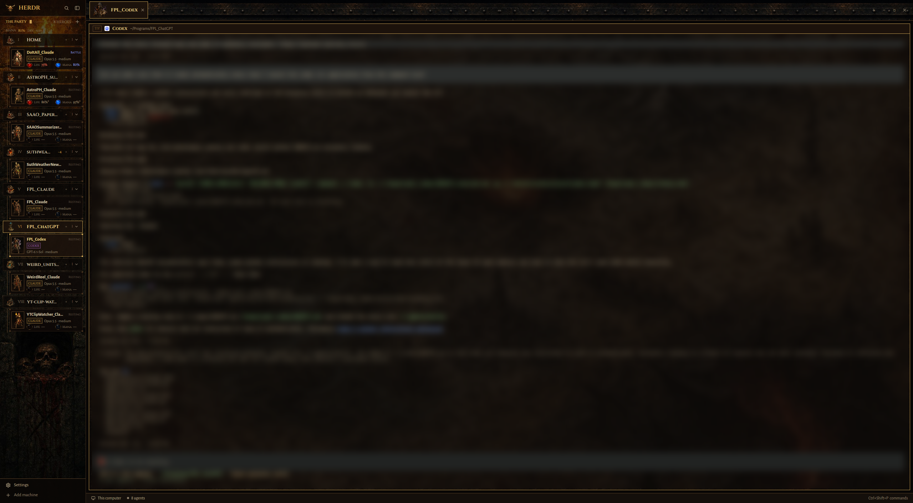

# Inferno

A dark gothic action-RPG layout for the [Herdr](https://herdr.dev) desktop app. Your coding agents become a party of heroes. Each hero is animated: it attacks while its agent works and raises a hand when the agent needs you. Each card has a red Life orb (context left) and a blue Mana orb (5-hour quota left). Spaces are realms, each listing its heroes under it. The terminal sits over a cursed map, the window is framed in iron and torchlit stone, and a demonic voice tells you when a hero needs you or a quest is done.



Inferno is built on the structure of [herdr-traveler](https://github.com/franky5440-afk/herdr-traveler) and works the same way as its sister layout, [herdr-collective](https://github.com/rbkuhn/herdr-collective): only the look and the sounds differ. All of its art, animation, sound and styling is new.

## Install

```sh
git clone https://github.com/rbkuhn/herdr-inferno
cd herdr-inferno
H=~/.config/herdr-app
cp layouts/inferno.json layouts/inferno.png "$H/layouts/"
cp themes/inferno.json "$H/themes/"
cp -r mods/inferno-agents mods/inferno-chrome mods/inferno-pane mods/inferno-spaces mods/inferno-summon mods/inferno-tabs mods/inferno-tree mods/layout-sounds "$H/mods/"
herdr-app do layout.switch '{"name":"inferno"}'
```

Then add the key from `keys.json` to your own `~/.config/herdr-app/keys.json`: copy its `"layout:inferno"` section in. It only applies while Inferno is showing.

If you already have `mods/layout-sounds` from herdr-collective, keep yours and add the `"inferno"` entry from this repo's `mods/layout-sounds/sounds.json` to it.

Press `ctrl-shift-l` to switch back. To remove Inferno, delete the files you copied.

## Using it

- **One tree**: each realm (space) lists its heroes under it. Click a realm's count to fold it; folded, a dot shows its most urgent hero.
- **Answer from the sidebar**: when a hero needs you, its card opens a NEEDS YOU panel with the question, one button per choice, Interrupt and a reply line. You don't leave the terminal you're in.
- **Scrying glass**: rest the pointer on a card to see the last lines of that hero's terminal. Click the card to go there.
- **Fuel warnings**: the line under the header shows the 5-hour quota left (MANA) and when it runs dry at the current pace. At 15% context a card turns red and offers COMPACT (sends `/compact`), and a toast warns you once.
- **Summon** (`ctrl-shift-a`, or a realm's `+`): pick a class, a realm, an installed agent and a first quest, and Enter starts it in a new tab named after the class, so it gets that hero.

The sidebar runs `hc` against your own agents: `hc read` to show a blocked or hovered hero's screen, and `hc keys`, `hc send` and `hc interrupt` only when you press a button. Nothing reaches the network.

The heroes only animate while at least one agent is working or blocked, and step 4 frames a second. With every agent resting, the sidebar doesn't redraw, so Herdr stays near idle.

### Optional: fill the Life and Mana orbs (Claude Code)

The orbs read a small cache file that a Claude Code statusline writes:

```sh
mkdir -p ~/.config/herdr-app/scripts
cp scripts/inferno-statusline.sh scripts/inferno-record.mjs ~/.config/herdr-app/scripts/
```

Then set Claude Code's statusline in `~/.claude/settings.json`:

```json
"statusLine": { "type": "command", "command": "/bin/sh ~/.config/herdr-app/scripts/inferno-statusline.sh" }
```

The script needs `node`. It records the numbers silently, so your statusline stays empty. If you already have a statusline, add a line to `inferno-statusline.sh` that pipes `$input` into it. If you already use Collective's or Traveler's statusline, skip this step: they write the same cache. Without any of them, the orbs show "—".

### Sounds

A demon speaks. When a hero needs you, "Mortal… your command is required." rises over a hellish rumble of fire and growls. When a quest is done, "The deed… is done." plays over a cathedral bell and doom gong. The layout carries a small invisible mod, `layout-sounds`, that sets these two sounds in `~/.config/herdr-app/settings.json` whenever Inferno comes on screen, so there is nothing to set up. Herdr's sounds setting is global: the sounds stay until you change them or switch to another layout that sets its own. Edit `mods/layout-sounds/sounds.json` to pick other files.

In `mods/inferno-chrome/sounds/`:

- `blocked_demon_a.mp3`, `done_demon_a.mp3`: the default pair (ElevenLabs voice "Matthew Schmitz – Unholy, Wicked Demon").
- `blocked_demon_b.mp3`, `done_demon_b.mp3`: the same lines in a more echoey voice ("Malyx – Echoey, Menacing and Deep Demon").
- `blocked_a/b.mp3`, `done_a/b.mp3`: the original wordless effects.

The voice and effect stems, and the command that mixes them, are in `scripts/inferno-sounds/`.

## Customise

- **Which hero a tab gets:** edit `mods/inferno-agents/jobs.json`. It maps tab names to classes: berserker, druid, huntress, necromancer, shadowblade, sorceress, templar or witch. Tabs not listed get a fixed class based on their name.
- **Which location a realm gets:** edit `mods/inferno-spaces/places.json`, e.g. `{"my-space": "hellgate"}`. The choices are cathedral, crypt, fortress, hellgate, tower and shrine.

## Credits and licences

- Code: Apache-2.0 (see `LICENSE` and `NOTICE`). It is adapted from Herdr's shipped mods and from herdr-traveler, both Apache-2.0.
- Art: the hero portraits, poses, locations, icons, orbs and backgrounds were generated with OpenAI image models for this project, then processed and animated by script. They are released under the same Apache-2.0 licence.
- Sounds: voices and effects generated with ElevenLabs on a paid plan (voices from the ElevenLabs voice library), mixed with ffmpeg. Released under Apache-2.0.
- Fonts: [Cinzel](https://github.com/NDISCOVER/Cinzel) and [Alegreya Sans](https://github.com/huertatipografica/Alegreya-Sans), SIL Open Font License 1.1 (see `mods/inferno-chrome/fonts/OFL-*.txt`).

Inferno is an original work. It is not affiliated with or endorsed by any game publisher.
