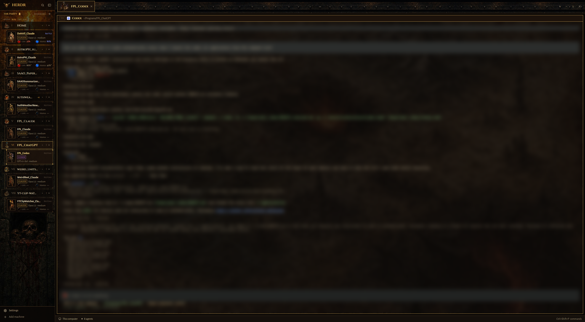

# Inferno

A dark gothic action-RPG window for Herdr. The left sidebar is a torchlit dungeon wall holding one tree: "The Party". Each space is a "Realm" row with a painted location (cathedral, crypt, fortress, hellgate, tower, shrine) and a Roman numeral, and each realm's agents hang under it as hero cards: an animated hero portrait, a status word, a program tag, and small red Life and blue Mana orbs. The tab bar is a riveted iron frieze with a hero bust on each tab. Terminals sit over a darkened, cursed map at 60% opacity, in panes with a bronze header. A demonic voice announces when a hero needs you and when a quest is done.

Inferno has the same structure and behaviour as herdr-collective; only the look and the sounds differ.

## What you see

Left to right, top to bottom:

- **Sidebar**: 240px wide, fixed. Background: `mods/inferno-chrome/art/sidebar.jpg` (cover), a stone wall darkened at the top so the list stays readable.
  - **Brand**: 46px, `#0a0705c0` with a `#5a4026` bottom line. A 30px horned-skull sigil, then "HERDR" in Cinzel 700 16px `#c9a052`. Search and sidebar-toggle buttons on the right. Draggable.
  - **The Party** (`inferno-tree`, the whole list area): a 31px header with "THE PARTY" in Cinzel 700 11.5px `#c9a052`, a still gold block, a `#5a4026` rule, "N HEROES" and a + (new space). Under it an 18px telemetry line: MANA, the lowest fresh 5-hour quota left (gold, `#e8b13a` under 30%, `#ff4433` blinking at 15% or less), "DRY ~Xm" (time to empty at the recent pace), and on the right "LOW LIFE N%" when any hero has 30% context or less. Then the realms: 34px rows with 26px location art, the realm's position as a Roman numeral in Cinzel 9px, the name in Cinzel 12.5px, the git tail and marks (`~n` uncommitted, `+n` unpushed, `!n` no remote, explained on hover), a + that opens Summon for that realm, and the hero count with a fold chevron. The active row is `#1c120bdd` with a 1px gold border; others are `#0a0705b8` with `#2a1d13`. Folded, a 6px dot in the most urgent hero's state colour (blinking when blocked). Each realm's hero cards hang under it, 12px in, on a 1px `#5a4026` tree line. Heroes whose realm isn't listed show under WANDERING.
  - **Footer**: 69px, `#0a0705d8`. Settings and Add machine.
- **Tab bar**: 58px over `mods/inferno-chrome/art/frieze.jpg`, a strip of iron bands and rivets. Tabs are 48px, with a 44px hero bust (when the tab maps to a class) and the name in Cinzel. The active tab is `#1c120bee` with a 1px accent border and `#e8cf8a` text; others are `#0a0705a0`. Then a + menu, Files (chained tome) and Changes (anvil). Window buttons sit on the right.
- **Terminal area**: 8px padding and gap. Every pane, even a lone one, has a 28px `inferno-pane` header, a 1px `#7a5a3299` border (accent when focused), radius 0, and `mods/inferno-chrome/art/map.jpg` behind the terminal at `terminal_opacity` 0.6.
- **Pane header**: `#0e0907` (`#1c120b` focused) with a `#5a4026` bottom line (accent focused). A framed terminal-id tag ("T11") in Cinzel 9px `#8a6a3a`, the program icon (tinted accent), the name in Cinzel 700, and the folder. On the right is the status. Split, zoom and close buttons appear on hover.
- **Status bar**: 28px, Herdr's `workspace-status` over `mods/inferno-chrome/art/footer.jpg`.
- **Theme** `inferno`: background `#0d0a08`, foreground `#d9ccb0`, accent `#c9a052`, solid `#a8221a`, working `#7088d8`, blocked `#e8442c`, done `#86a852`, idle `#6e6050`, chrome `#140f0b`, surface `#1a130e`, raised `#2b2017`, border `#7a5a3299`. ANSI: `#0d0a08 #c8402e #86a852 #cfa54e #7088d8 #a96cbc #62a89e #d9ccb0 / #6e6050 #e8604a #a2c46c #e8c672 #95a8ee #c78ed8 #84c6ba #f4ead2`.
- **Fonts**: the UI font is Alegreya Sans. Cinzel is used for names, labels and headers. Both are bundled in `mods/inferno-chrome/fonts/`.

### A hero card

About 60px tall. The background is `#0e0907e0`, or `#1c120bea` when focused, with a 1px `#2a1d13` border (state colour at 60% when focused or blocked, `#ff4433` when context is critical). A 4px square rivet sits on each corner.

- **Portrait**: 36×48, `#0b0806`, 1px `#5a4026` border (blocked-red when blocked), showing the hero's animation for its state.
- **Line 1**: the tab name (700, 12.5px; `#a9b8ff` working, `#ff7a62` blocked, `#e8cf8a` focused), then the state word in Cinzel 8.5px: Battle, Needs you (blinking), Victory or Resting. Heroes sharing a tab get their terminal id in front of the name.
- **Line 2**: a framed CLAUDE (or CODEX) tag with "model · effort".
- **Line 3**: Life and Mana side by side: a 16px orb filled in 5% steps (`mods/inferno-agents/orbs/`), a Cinzel label and the value. "—" with an empty orb when there is no data, a `*` after 5 minutes without an update.
- **Needs you** (blocked): a red panel under the card. It shows the question (the last 3 screen lines before the choices) and one button per choice: a numbered prompt presses the digit, an arrow list presses up/down then Enter, and with no choices Approve presses Enter. Then Interrupt, and a reply line (Esc first on a choice list, then `hc send --force`). A result line shows for 5 s.
- **Life critical** (15% context or less): a flashing "LIFE n% · ~Xm" bar with a COMPACT button that sends `/compact`.
- **Hover** for 400 ms: the scrying glass, a 560px panel hung right of the card from a 1px gpui `Popup` anchor. It shows the name, state, address, details (place in the party, class, session name, context and quota left with time to empty) and the screen's last 16 lines, read with `hc read` every second. It doesn't open while the pointer is on the answer panel.

### Summon

A 540×480 frameless dialog (`#0e0907f6`, 1px gold border). "SUMMON A HERO", then chips for CLASS (each with its portrait; Tab cycles), REALM, and AGENT (installed agents on that realm's machine), a QUEST box for an optional first message, and CANCEL / SUMMON buttons. A class named after an agent ("Codex", "Claude Code") also picks that agent.

## How it behaves

- **Hero animation** per agent state. Each state is a horizontal strip of 144×192 frames (`mods/inferno-agents/anim/<class>-<state>.webp`), cut by `scripts/inferno-frames.py` into one 72×96 PNG per frame (`mods/inferno-agents/frames/<class>/<state>/NN.png`) and shown at 36×48. Frames: rest 16, done 16, working 20, blocked 12. The cards step one frame every 250 ms, each hero starting its loop at its own point. The rest pose's first frame sits under each frame while it loads.
  - **Resting** (idle, or no status): breathing, a slight sway, torchlight flicker, drifting dust.
  - **In battle** (working): a wind-up, a white impact flash, then the attack with the class effect: slash arcs for berserker and templar, purple cross slashes for shadowblade, an arrow for huntress, a fire blast for sorceress, a green bolt for necromancer, a thrown potion for witch, a ground shockwave for druid. An orange aura and embers run throughout.
  - **Needs you** (blocked): the hero raises one hand. A blood-red aura pulses and a red "!" bobs.
  - **Victorious** (done): the resting loop with a gold aura and twinkling motes.
- **Classes**: `mods/inferno-agents/jobs.json` maps tab names to classes, matched case-insensitively. Unmapped tabs get a class from a hash of their name, skipping classes already used until all 8 are taken.
- **Locations**: `mods/inferno-spaces/places.json` maps space names to places. Other spaces get a place from a hash of their name.
- **Pane header status**: "IN BATTLE" with a natively spinning ring (`spin(900)`) while working, "NEEDS YOU" blinking red while blocked, "VICTORIOUS" in green when done.
- **Sounds**: the floating `layout-sounds` mod writes `sounds.done`/`sounds.blocked` in `settings.json` to `done_demon_a.mp3`/`blocked_demon_a.mp3` when Inferno comes on screen.
- Click a card to run `agent.focus` (no sound). Click a realm to select it, right-click for its menu, drag to reorder. Tabs: click selects, double-click renames, drag reorders, right-click opens a menu, the mouse wheel cycles. Files and Changes toggle the right panel, remembered per space.

## Built from

- **Layout tree**: root `row`: `sidebar` column [`brand` block `inferno-chrome`, `sidebar-lists` block `inferno-tree`, `sidebar-footer` `inferno-chrome` with props `{footer:true}`] and `work` column [`tabs` `inferno-tabs`, `work-body` row [`main` `{tab:"active"}` with a pane frame whose header is `inferno-pane`, `panel` column (hidden) holding a `panel-body` stack of `files`/`changes`], `status` `workspace-status`]. Root: `theme: "inferno"`, `ui_font: "Alegreya Sans"`, `terminal_opacity: 0.6`, `terminal_padding: [14,12]`, `titlebar: "none"`, divider 1px `#3a2a1a`, `preview: "layouts/inferno.png"`, and one `floating` block, `layout-sounds` (bottom, end), which draws nothing.
- **inferno-tree**: the sidebar list, the same code as herdr-collective's `collective-tree` with the look changed. `main.js` is the realm list with each row followed by its heroes (`agents()` grouped by `space`), per-realm folds in `localStorage` (`sectors.folded`), and `setAgentOrder` in tree order. `agents.js` is the card code as a `Roster` class the tree calls (`prepare(cx)` once per render, `card(...)` per hero). Its clock is one `cx.timer.every(250)` that does nothing unless an agent is working or blocked; then it calls `cx.notify()` every tick while `window().active`, every fourth otherwise. `ask.js` reads a blocked screen into its question and choices, and the feed's last lines. `telemetry.js` samples each hero's context and quota from the statusLine cache, works out time to empty over the last 45 minutes, and keeps it in `localStorage`. `lib.js` holds the class list, `designation()` ("Third of five"), the animation table and `orbPath()`. It uses `hc(["read"|"keys"|"send"|"interrupt", …])` and `notify`. Life and Mana come from `data/traveler/sessions/<terminal>.json` (`{updatedAt, contextRemainingPct, fiveHourRemainingPct, sessionName, model, effort}`), read with `readTextFile` and `watchFolder`; remote agents are read with `readTextFile(..., {on})` every 60 s. Its art and `jobs.json` stay in `mods/inferno-agents/` and `mods/inferno-spaces/`.
- **inferno-summon**: the Summon dialog (`mod.json` overlay: dialog, `frame: "none"`, 540×480), the same code as `collective-assimilate`. Classes come from `mods/inferno-agents/jobs.json` with their portraits, realms from `spaces()`, agents from `knownAgents({on})`. Enter runs `tab.new {space, name: class, argv, task}`. Opened by `keys.json`'s `layout:inferno` `ctrl-shift-a` (`mod.open:inferno-summon`) or a realm's + (`openOverlay` with `props.space`).
- **inferno-pane**: the same code as `collective-pane` (a clone of Herdr's `pane` mod), restyled. It reads `panes()` and runs `pane.split`, `pane.zoom` and `pane.close`.
- **inferno-tabs**, **inferno-chrome**: restyled clones of herdr-traveler's mods, which are clones of Herdr's `tabs` and `workspace-chrome`. `inferno-chrome` also holds the fonts, sounds and backgrounds.
- **inferno-agents**, **inferno-spaces**: the original separate party and realm lists, kept for their art (`art/`, `anim/`, `frames/`, `orbs/`), `jobs.json` and `places.json`. The layout no longer shows them.
- **layout-sounds**: sets the shown layout's sound pair from `sounds.json` into `settings.json`, only when they differ.
- **scripts/inferno-statusline.sh** with **inferno-record.mjs**: a Claude Code statusLine. It reads `context_window.remaining_percentage` (or `100 - used_percentage`) and `rate_limits.five_hour.used_percentage` from stdin. It writes the cache file named by `$HC_TERMINAL_ID`, atomically, and prints nothing.
- **Art**: hero busts, full-body heroes, attack and calling poses (image edits of the full-body hero), locations, icons and orb liquids were generated with OpenAI image models on transparent backgrounds. Backgrounds were generated opaque. The orbs are composited in 21 fill levels plus empty. The hero strips are composited by script, with auras, effects and particles baked in over an opaque `#0b0806` stage.
- **Sounds**: ElevenLabs text-to-speech (`eleven_multilingual_v2`) with two library demon voices, and two ElevenLabs sound effects (a hellish rumble, a bell and doom gong). Each voice line is normalized to -16 LUFS, delayed 0.4 s, mixed over its effect at -28 LUFS, and the mix normalized to -16 LUFS. Stems and the command are in `scripts/inferno-sounds/`.

## Watch out

- **Herdr's `image()` draws only the first frame of a GIF or animated WebP.** Sprites must be stepped from the mod. A strip slid by an offset lands between frames at fractional display scales and the hero drifts, so the cards use one PNG per frame.
- **Every `cx.notify()` redraws the whole window.** An 80 ms animation timer kept Herdr at about 85% of a core. Step only while something is working or blocked, and never animate the always-visible header with `.loop()`: a native loop still repaints the window about 30 times a second.
- **Write a new mod's `mod.json` before its other files.** Herdr docks a mod folder it sees without one into the shown layout as a 320px block, and remembers it. Check `layouts/*.json` for stray root children after adding mods.
- GIF transparency is 1-bit and leaves jagged halos on painted art. That's why the strips are opaque with the stage colour baked in.
- Scale every pose of a hero by the same factor and align the poses on the feet. Fitting each pose to the frame makes the hero shrink when attacking.
- The sidebar art must stay dark behind the list: a bright torch there makes the names unreadable.
- Cinzel needs about 1.5px more than a pixel font at the same size to stay legible: keep its labels at 8.5px or more.
- The Life/Mana cache shares `data/traveler/sessions` with herdr-traveler and herdr-collective on purpose, so any of their statuslines fills all three layouts.
- Sounds are a global Herdr setting: they play in every layout until another layout's `layout-sounds` entry replaces them.
- If one space ever draws in another layout's theme, restart the Herdr window. A fresh window applies the layout theme to every terminal.

## Done when

- `herdr-app check` passes for all seven `mods/inferno-*` folders and `mods/layout-sounds`, and `herdr-app status` shows `"layout": "inferno"` with no errors.
- A working Claude Code agent's hero visibly attacks, with its class effect, in screenshots half a second apart. A blocked agent's hero raises a hand under a red "!". With every agent resting, Herdr's CPU use drops to a few percent.
- With the statusline installed, a Claude Code card shows Life and Mana percentages that match its context and 5-hour usage. Without it, the orbs show "—".
- Realm rows show location art and Roman numerals, and the active realm has a gold frame. Tabs show hero busts. Files and Changes toggle the right panel.
- A blocked Claude Code agent's card shows its question and one button per choice; pressing one answers it, and the panel goes when the agent moves on.
- Resting the pointer on a card opens the scrying glass with that terminal's last lines.
- `ctrl-shift-a` opens Summon; Enter starts the chosen agent in a tab named after the class, with that class's hero.
- Switching to Inferno sets `settings.json`'s sounds to the demon pair; a finished agent plays "The deed… is done."
